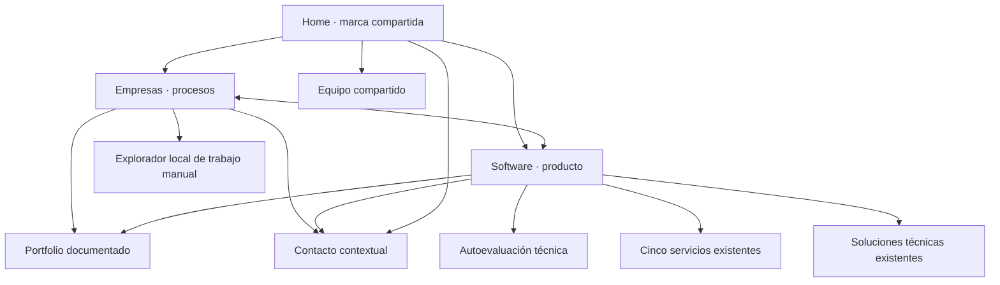

# Arquitectura comercial e información

2026-10-13. Una marca, dos recorridos, ES/EN.

```text
tenbeltz.com / en
├── /ia-para-empresas ↔ /en/ai-for-business
│   ├── Aplicaciones con evidencia y enlaces al portfolio
│   ├── Explorador local (#explorar-proceso)
│   └── Contacto contextual (#contact-section)
├── /ia-para-software ↔ /en/ai-for-software
│   ├── Cinco modalidades → /services y anclas existentes
│   ├── Soluciones: evaluación / voz / IA privada
│   ├── Diagnóstico técnico → /diagnostico-ia
│   └── Contacto contextual (#contact-section)
├── /casos ↔ /en/case-studies
├── /quien-esta-detras ↔ /en/who-is-behind
├── /aritz ↔ /en/aritz
└── /politicas ↔ /en/politicas
```



| Página | URL ES | URL EN | Navegación | Prioridad |
|---|---|---|---|---|
| Home | / | /en | Logo | Alta |
| Empresas | /ia-para-empresas | /en/ai-for-business | Header, home, footer | Alta |
| Software | /ia-para-software | /en/ai-for-software | Header, home, footer | Alta |
| Portfolio | /casos | /en/case-studies | Header, evidencias, footer | Alta |
| Equipo | /quien-esta-detras | /en/who-is-behind | Header, método, footer | Alta |
| Servicios software | /services | /en/services | Software, footer | Media |
| Diagnóstico técnico | /diagnostico-ia | /en/ai-diagnosis | Software, primer paso home | Media |

Las otras rutas existentes permanecen con canonical propio. No hay redirecciones nuevas ni cambios de URLs previas. Fuente compartida de slugs: src/i18n/routes.js. Se conservan los breadcrumbs estructurados; header y footer enlazan las landings directamente y cada landing ofrece el otro recorrido al final.

Home incluye dos caminos visibles en hero y una presentación con valor/CTA de cada uno. Las campañas pueden enlazar directamente cada landing. El portfolio, equipo y responsabilidades no se duplican por público. La autoevaluación técnica no se presenta como diagnóstico de retorno para pymes.
