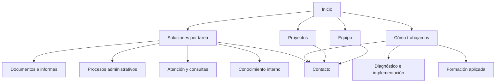

# Mapa de páginas y recorrido comercial

## Navegación propuesta

**Soluciones · Cómo trabajamos · Proyectos · Equipo · Hablemos · Idioma**

La marca enlaza al inicio. «Soluciones» lleva a la página existente de IA para empresas, convertida en índice por tareas. «Cómo trabajamos» lleva a la oferta en `/services`. «Hablemos» lleva al formulario de la página actual o al contacto de la home. El selector de idioma mantiene la página equivalente.

Las páginas por tarea son propuestas de contenido. Las rutas nuevas no deben enlazarse desde la web hasta estar implementadas y verificadas.

## Páginas principales

| Página ES | Página EN | Función y contenido |
| --- | --- | --- |
| `/` | `/en` | Propuesta, tareas reconocibles, casos, oferta, equipo, preguntas y contacto |
| `/ia-para-empresas` | `/en/ai-for-business` | Índice de las cuatro soluciones; ejemplos, condiciones de encaje y casos |
| `/services` | `/en/services` | Diagnóstico, implementación, adopción y formación; entregables y presupuesto por alcance |
| `/casos` | `/en/case-studies` | Problema, intervención, resultado comprobado y atribución; detalle técnico secundario |
| `/quien-esta-detras` | `/en/who-is-behind` | Equipo, responsabilidades y experiencia |
| `/aritz` | `/en/aritz` | Trayectoria personal; conservar separada de la oferta corporativa |
| `/diagnostico-ia` | `/en/ai-diagnosis` | Orientación de procesos para responsables de negocio, pendiente de rediseño |
| `/politicas` | `/en/politicas` | Información legal y privacidad vigentes |

No se necesita una nueva ruta de contacto: se conserva `#contact-section` y el formulario abierto. Se pueden mantener las rutas actuales de servicios aunque su etiqueta visible sea «Cómo trabajamos».

## Soluciones por tarea

| Área | Ruta ES propuesta | Ruta EN propuesta | Contenido y evidencia |
| --- | --- | --- | --- |
| Documentos e informes | `/documentos-e-informes` | `/en/documents-and-reports` | Clasificación, extracción y borradores; clasificación documental e informes periciales |
| Procesos administrativos | `/automatizacion-administrativa` | `/en/administrative-automation` | Correo, documentos y propuestas de tareas; gestión de despachos |
| Atención y consultas | Conservar `/agentes-voz-saas` | Conservar `/en/voice-agents-for-saas` | Reescribir para negocio, explicando voz y conexión con sistemas; Qamarero y colaboración Irontec |
| Conocimiento interno | Conservar `/ia-privada-productos` | Conservar `/en/private-ai-products` | Búsqueda con fuentes, permisos y opciones de despliegue; Biiak como producto cofundado |

Las dos últimas conservan temporalmente slugs históricos específicos. Un eventual cambio a rutas más generales exige decidir y probar redirecciones 301 antes de publicar; el contenido y la navegación se pueden reorientar conservando las URLs.

Cada página debe explicar situaciones de partida, qué puede hacer la solución, integración y datos necesarios, excepciones/revisión, un caso documentado y el siguiente paso. No crear páginas por sector a partir de ejemplos hipotéticos.

## Tratamiento de las páginas orientadas a software

| Ruta ES actual | Equivalente EN actual | Tratamiento propuesto |
| --- | --- | --- |
| `/ia-para-software` | `/en/ai-for-software` | Retirar de la navegación principal y de la home; conservar acceso directo durante la transición y actualizar su contexto sin prometer una línea comercial prioritaria |
| `/evaluacion-ia-saas` | `/en/ai-evaluation-for-saas` | Conservar como página técnica de acceso directo, con enlaces a casos y contacto; revisar después su utilidad con datos de consultas e indexación |
| `/agentes-voz-saas` | `/en/voice-agents-for-saas` | Reorientar como solución de atención; conservar URL inicialmente |
| `/ia-privada-productos` | `/en/private-ai-products` | Reorientar como solución de conocimiento interno con privacidad según proyecto; conservar URL inicialmente |

La nueva decisión cambia la prioridad de captación, no la historia de los proyectos. Qamarero mantiene su condición de cliente SaaS. Ninguna URL se elimina en esta fase documental.

## Orientación de procesos

Título propuesto: **«Encuentra un primer proceso para aplicar IA»**. Debe ayudar a preparar una conversación. La consultoría de diagnóstico incluye un análisis y unos entregables distintos.

Preguntas propuestas, con respuesta «No lo sé todavía» cuando corresponda:

1. ¿Qué trabajo te gustaría mejorar? Documentos, administración, atención, búsqueda interna, formación u otro. Admitir «Necesito orientación».
2. ¿Cómo lo hacéis ahora? Descripción breve.
3. ¿Con qué frecuencia se repite? Diaria, semanal, mensual o variable.
4. ¿Cuánto tiempo dedicáis en total? Tiempo aproximado del equipo por periodo, opcional.
5. ¿Qué herramientas utilizáis? Texto libre opcional.
6. ¿De dónde sale la información? Documentos, correo, sistema de gestión u otras fuentes.
7. ¿Hay información sensible o accesos restringidos? Sí, no o por revisar.
8. ¿Quién revisa el resultado o resuelve excepciones? Rol, sin datos de terceros.
9. ¿Qué os gustaría mejorar primero? Tiempo, errores, capacidad de atención, acceso a información u otro.
10. ¿En qué punto estáis? Explorando, eligiendo proceso, buscando implementación o necesitando formación.

Resultado propuesto: resumen de la necesidad, información que falta y sugerencia de siguiente conversación. Si no existe un proceso definido, orientar al diagnóstico; si el alcance está claro, a revisión de implementación; si la necesidad es aprendizaje, a formación.

Eliminar la nota técnica global de 1 a 10 de este nuevo recorrido. El tiempo declarado describe carga de trabajo; no equivale a ahorro potencial ni determina viabilidad. Las respuestas deben permanecer locales hasta una acción explícita de compartir; la implementación deberá comprobar envío y consentimiento. El diagnóstico técnico actual conserva su funcionamiento hasta ser sustituido y no se renombra como si ya midiera procesos de negocio.

## Componentes que cambiarán al implementar

- `LandingPage.astro`: sustituir la doble audiencia por el nuevo recorrido.
- `Header.astro`, `Footer.astro` y `src/data/audiences.ts`: navegación y mensajes coherentes.
- `Contact.astro` y `ContactForm.tsx`: preguntas e intereses orientados a necesidad; conservar puente de envío y formulario abierto.
- `DiagnosisLauncher.astro`: retirar la dependencia de `#elige-tu-camino` cuando desaparezca esa sección; orientar al nuevo acceso solo cuando exista.
- Plantillas de soluciones, servicios y casos: texto y jerarquía para negocio en ambos idiomas.
- `AIDiagnosis.tsx` y su PDF: rediseño funcional separado de un simple cambio de etiquetas.
- Metadatos, JSON-LD, `llms.txt`, recursos sociales y kit de marca: revisar descripciones comerciales al llevar el cambio a la web.

## Condiciones para publicar

Conservar el mapa compartido de idiomas, canonicals y convención sin barra final. Añadir las parejas nuevas a `src/i18n/routes.js`; verificar sitemap y selector de idioma. La transición debe incluir también el copy inglés y los metadatos de las páginas que sigan accesibles.

Comprobar enlaces y anclas, contacto sin envíos reales durante QA, navegación por teclado, contenido sin JavaScript, móvil y reducción de movimiento. No se atribuye crecimiento de tráfico ni indexación a esta propuesta. El historial y backlog de SEO registran la preparación; los checks de aplicación corresponden a la implementación.
